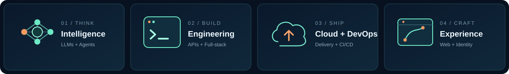
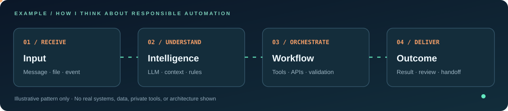

### Intelligent systems. Intentional experiences.

**LLMs** &nbsp;·&nbsp; **Agentic Systems** &nbsp;·&nbsp; **Automation** &nbsp;·&nbsp; **DevOps & Cloud** &nbsp;·&nbsp; **Full-Stack** &nbsp;·&nbsp; **Digital Design**

### `01 / hello` 

I'm **Jad**, an AI engineer and creative-minded builder who likes working across the entire product lifecycle — **from agent logic and backend architecture to deployment, interfaces, and visual identity**.

I build practical LLM applications, connect agents to tools and workflows, automate busywork, and create digital experiences that feel as considered as the systems behind them.

> **What drives my work:** turn complex processes into reliable products, without sacrificing the human experience.

### `02 / where I focus`

| Intelligence | Engineering | Experience |
|:--|:--|:--|
| **LLMs & multimodal APIs** | **DevOps & CI/CD** | **Full-stack web apps** |
| **Tool-using agents** | **Containers & Linux** | **Responsive web design** |
| **RAG & structured outputs** | **Cloud deployment workflows** | **Creative direction** |
| **Workflow orchestration** | **REST APIs & integrations** | **Visual identities & UI systems** |
| **Human-in-the-loop design** | **Automation & data pipelines** | **Motion-led storytelling** |

### `03 / private work, public lessons`

Some of my most meaningful engineering work happens in private environments. These are **deliberately anonymized, high-level examples** of the systems I've worked on — focused on transferable engineering skills, not company internals.

| Case study | Public-safe demonstration | Core skills |
|:--|:--|:--|
| **Operations AI assistant** · Internally deployed | Operational message → intent understanding → controlled API action or human review. | Python · LLM integration · Microsoft Graph · REST APIs |
| **Business reporting automation** · Delivered work | Repeated input files → validation and transformation → reusable reports and dashboards. | Python · spreadsheets · data pipelines · scheduling |
| **Field-operations intelligence** · Delivered work | Location or operational events → backend processing → useful monitoring and analytical views. | FastAPI · MySQL · REST APIs · geospatial processing |
| **Conversational agent prototypes** · In development/exploration | User conversation → structured information → workflow follow-up or human handoff. | LLM APIs · tool calling · workflow design · guardrails |

**Privacy by design:** no private repository links, client names, screenshots, live data, business metrics, deployment topology, or proprietary process details. The diagram above is illustrative rather than a production architecture.

### `04 / things you can actually open`

| Open project | What it demonstrates |
|:--|:--|
| **[Qwen2.5-VL API Server](https://github.com/Jad-RAMOSS/qwen2.5-VL-inference-openai)** | An OpenAI-compatible multimodal API server with image understanding, Docker, and GPU-oriented service setup. **LLMs · Python · APIs · Docker** |
| **[Automated HR Dashboard](https://github.com/Jad-RAMOSS/hr_dashboard)** | A reporting interface that automatically rebuilds when its source data and configuration change. **Automation · GitHub Actions · Web deployment** |
| **[Forge AI Identity](https://github.com/Jad-RAMOSS/ForgeAI_Identity)** | The design and web presence for an AI-focused venture. **Web design · Digital identity · Creative direction** |

### `05 / toolkit`

**`BUILD /`**  

**`SHIP /`**  

**`INTELLIGENCE /`**  
`LLMs` · `Agentic Workflows` · `OpenAI-compatible APIs` · `RAG` · `Tool Calling` · `Structured Outputs`

**`CRAFT /`**  
`Web Design` · `UI/UX` · `Design Systems` · `Creative Direction` · `Visual Identity` · `Motion Concepts`

### `06 / contribution signal`

**SIGNAL PATH** — a custom animated activity visualization, refreshed daily with GitHub Actions. No classic contribution snake.

---

**Architect the intelligence. Engineer the experience. Design the details.**

<a href="https://github.com/Jad-RAMOSS?tab=repositories">Explore my repositories</a> &nbsp;·&nbsp; <a href="https://github.com/Jad-RAMOSS/ForgeAI_Identity">Explore Forge AI</a>

Made with Python, SVG, GitHub Actions, and a slightly unreasonable appreciation for good spacing.

