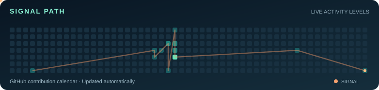

### Intelligent systems. Intentional experiences.

**LLMs** &nbsp;·&nbsp; **Agentic Systems** &nbsp;·&nbsp; **Automation** &nbsp;·&nbsp; **DevOps & Cloud** &nbsp;·&nbsp; **Full-Stack** &nbsp;·&nbsp; **Creative Direction**

### `01 / hello`

I'm **Jad**, an AI engineer and creative-minded builder working across the entire product lifecycle — **from LLM orchestration, agent logic, and backend architecture to deployment, interfaces, and visual identity**.

I build practical AI systems, connect agents to tools and workflows, automate repetitive processes, and create digital experiences that feel as considered as the engineering behind them.

> **My approach:** Architect the intelligence. Engineer the experience. Design the details.

### `02 / explore live work`

**I prefer showing something you can actually use or visit.** These are the live products, websites, and organizations connected to my work — with clear distinctions between personal projects and my workplace.

<table>
<tr>
<td width="50%" valign="top">

#### 🤖 Forge AI

**AI venture · Agentic systems · Web & creative engineering**

A creative-technology venture focused on intelligent workflows, agentic solutions, and distinctive digital experiences. A meeting point between systems engineering and visual storytelling.

**Explore:** `LLM systems` · `Automation` · `Creative direction` · `Web design`

</td>
<td width="50%" valign="top">

#### 🍽️ Luqma AI

**iPhone app · AI-powered nutrition tracking**

A voice-first calorie and macro tracker that understands meals described in English or Egyptian Arabic, bringing natural-language interaction into everyday health tracking.

**Explore:** `LLM-powered features` · `Product UX` · `App delivery` · `Structured data`

</td>
</tr>
<tr>
<td width="50%" valign="top">

#### 🕯️ Candle Club

**Brand experience · Visual identity · Website**

A warm, premium digital brand experience for a candle label, bringing product presentation, visual identity, and web design together with a consistent creative direction.

**Explore:** `Web design` · `Brand identity` · `UI/UX` · `Creative direction`

</td>
<td width="50%" valign="top">

#### 💳 Damen ePayment

**Workplace · Applied AI engineering · Fintech**

I work on internal engineering and automation initiatives in the digital-payments space. The public company website is linked for context; the internal solutions I contribute to are described separately below, without exposing proprietary details.

**Explore:** `AI automation` · `Integrations` · `Backend engineering` · `Operational systems`

</td>
</tr>
</table>

**Attribution:** Damen is my employer, not a website I claim to have built. The other destinations showcase products, a venture, and creative work I have worked on; the links lead to the live experience rather than an implementation repository.

### `03 / where I focus`

| Intelligence | Engineering | Experience |
|:--|:--|:--|
| **LLMs & multimodal APIs** | **DevOps & CI/CD** | **Full-stack web apps** |
| **Tool-using agents** | **Containers & Linux** | **Responsive web design** |
| **RAG & structured outputs** | **Cloud deployment workflows** | **Creative direction** |
| **Workflow orchestration** | **REST APIs & integrations** | **Visual identities & UI systems** |
| **Human-in-the-loop design** | **Automation & data pipelines** | **Motion-led storytelling** |

### `04 / private work, public lessons`

Some of my engineering work happens in private environments. These are **deliberately anonymized, high-level examples** focused on transferable skills — **not** disclosures of company internals.

| Case study | Public-safe demonstration | Core skills |
|:--|:--|:--|
| **Operations AI assistant** · Internally deployed | Operational message → intent understanding → controlled API action or human review. | Python · LLM integration · Microsoft Graph · REST APIs |
| **Business reporting automation** · Delivered work | Repeated input files → validation and transformation → reusable reports and dashboards. | Python · spreadsheets · data pipelines · scheduling |
| **Field-operations intelligence** · Delivered work | Location or operational events → backend processing → useful monitoring and analytical views. | FastAPI · MySQL · REST APIs · geospatial processing |
| **Conversational agent prototypes** · In development/exploration | User conversation → structured information → workflow follow-up or human handoff. | LLM APIs · tool calling · workflow design · guardrails |

**Privacy by design:** no private repo links, client names, screenshots, live data, financial figures, server details, or proprietary processes. The diagram is illustrative, not a production architecture.

### `05 / toolkit`

**`BUILD /`**  

**`SHIP /`**  

**`INTELLIGENCE /`**  
`LLMs` · `Agentic Workflows` · `OpenAI-compatible APIs` · `RAG` · `Tool Calling` · `Structured Outputs`

**`CRAFT /`**  
`Web Design` · `UI/UX` · `Design Systems` · `Creative Direction` · `Visual Identity` · `Motion Concepts`

### `06 / contribution signal`

**SIGNAL PATH** — my contribution activity, reimagined as a glowing signal path. Regenerated daily using GitHub Actions. No snake clone.

<b>For developers: selected code and technical experiments</b>

 

- [Qwen2.5-VL API server](https://github.com/Jad-RAMOSS/qwen2.5-VL-inference-openai) — OpenAI-compatible multimodal server, Docker, and GPU-oriented setup.
- [Automated HR dashboard](https://github.com/Jad-RAMOSS/hr_dashboard) — reporting and CI/CD automation.
- [Forge AI identity source](https://github.com/Jad-RAMOSS/ForgeAI_Identity) — website and brand engineering source.

---

**Architect the intelligence. Engineer the experience. Design the details.**

<a href="https://forgeai.services">Forge AI</a> &nbsp;·&nbsp; <a href="https://apps.apple.com/eg/app/luqma-ai/id6816405004">Luqma AI</a> &nbsp;·&nbsp; <a href="https://candle-club-website.vercel.app">Candle Club</a> &nbsp;·&nbsp; <a href="https://damen.com.eg">Damen</a>

Made with Python, SVG, GitHub Actions, and a slightly unreasonable appreciation for good spacing.

